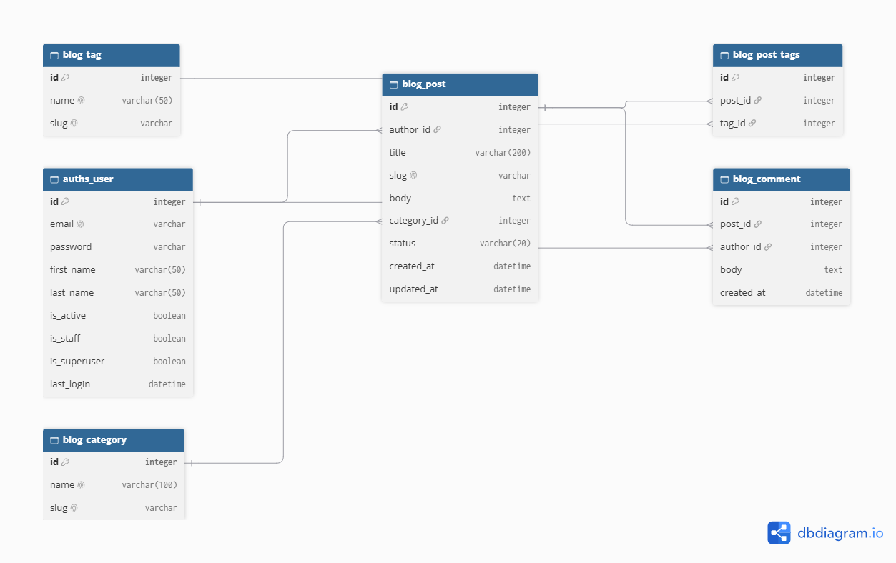
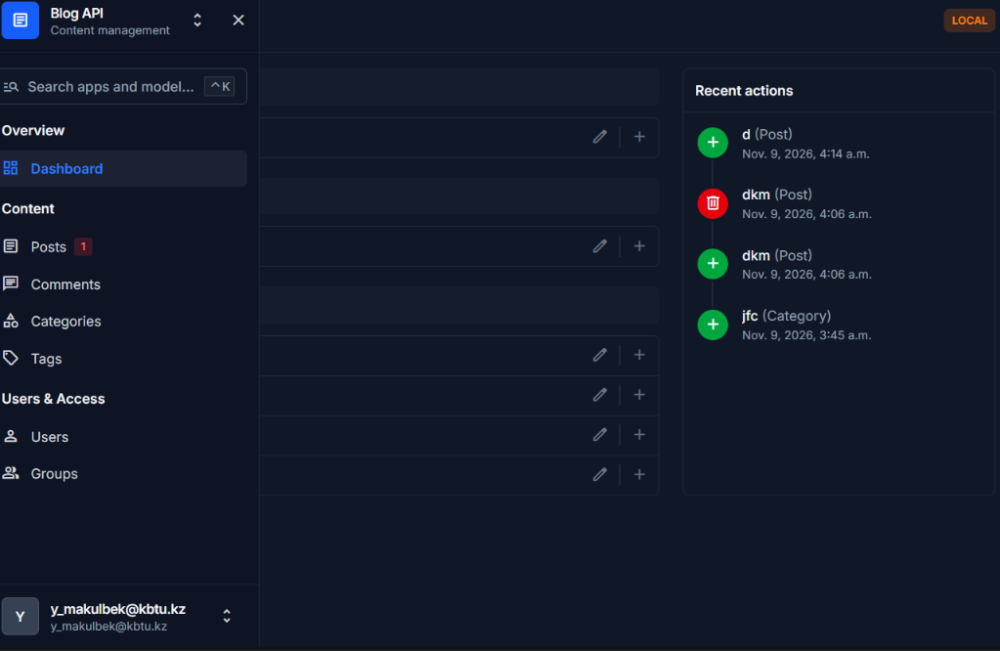
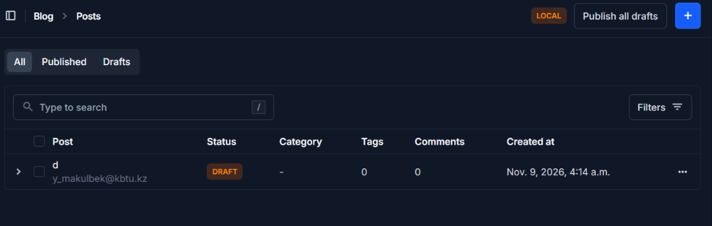
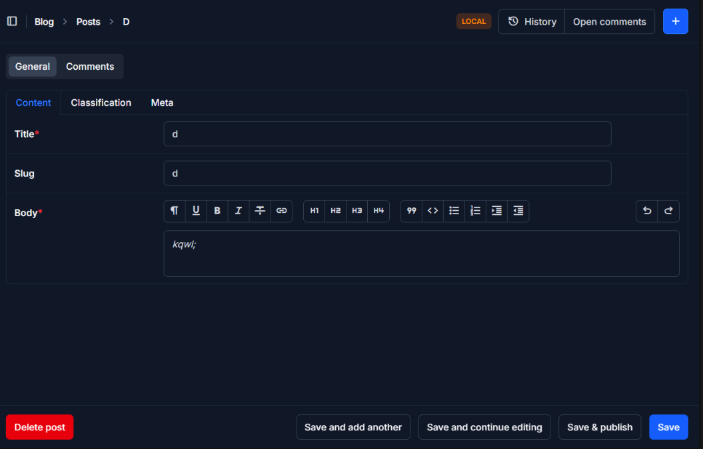
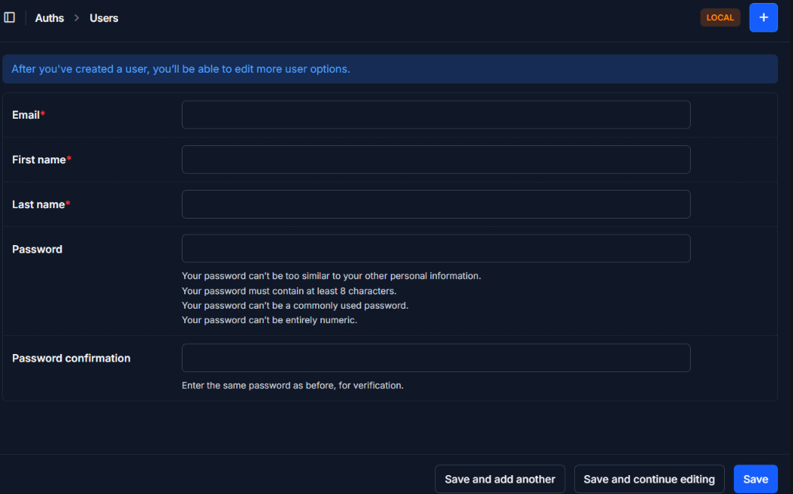

# Blog API

Blog REST API on Django.

## Structure

- `apps/auths` — custom user model (login by email)
- `apps/blog` — posts, comments, categories, tags
- `settings/` — project package; `env/local.py` and `env/prod.py` are environment overrides

## Setup

    python -m venv venv
    venv\Scripts\activate
    pip install -r requirements/dev.txt

Create `settings/.env`:

    BLOG_SECRET_KEY=b5knogn--3=%q7mnty!z^m+=@jbzu3%_+_yjn0)sb+^9sr!d+$
    BLOG_ENV_ID=local
    BLOG_ALLOWED_HOSTS=localhost,127.0.0.1

Then:

    python manage.py migrate
    python manage.py createsuperuser
    python manage.py runserver

## ERD

## Seeding

    python manage.py seed
    python manage.py seed --users 50 --posts 300 --comments 1500
    python manage.py seed --clear

Arguments: `--users` (20), `--posts` (100), `--comments` (500), `--clear`.
All seeded users have the password from `SEED_PASSWORD` in `seed.py`.

## Admin

Admin is built with Django Unfold: `/admin/`.

